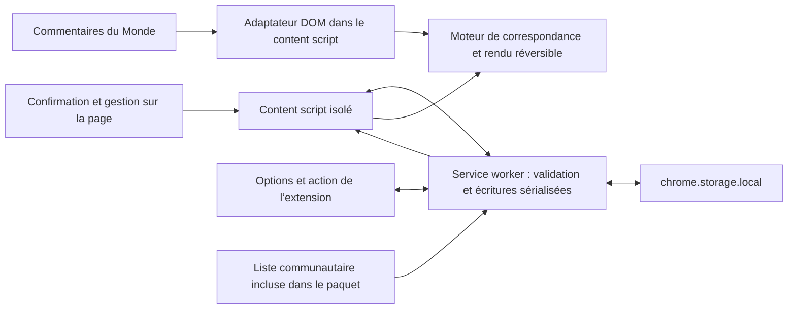

# Architecture proposée

Document de conception, 4 novembre 2026. Aucun des composants décrits ci-dessous n’est encore implémenté.

## 1. Socle

Extension Chrome Manifest V3 en TypeScript, avec HTML/CSS pour les interfaces. Un bundler léger produit des fichiers JavaScript et CSS locaux ; aucune bibliothèque d’interface ou dépendance réseau n’est nécessaire au départ. Les versions de dépendances seront figées par un lockfile lors de l’implémentation.

TypeScript est utile pour les messages, les règles d’auteur, les migrations et les états de l’interface. Il ne remplace pas la validation à l’exécution des données importées, du DOM ou des messages.

## 2. Composants et flux



- **Adaptateur DOM** : reconnaître la discussion courante, chaque commentaire, son auteur, son contenu propre, ses réponses et l’action de signalement. Il ne décide pas de la politique de blocage.
- **Moteur de règles pur** : déterminer afficher/masquer et la règle responsable à partir d’une identité et d’un état. Il ne lit ni le DOM ni le stockage.
- **Rendu réversible** : ajouter les actions, masquer uniquement les parties requises, préserver les réponses et restaurer les éléments. Les modifications sont identifiées et nettoyées.
- **Content script en monde isolé** : coordonner le suivi du DOM, les interfaces et le cache de règles pour l’article courant. Aucun script dans le monde principal de la page n’est nécessaire.
- **Service worker** : initialiser/migrer l’état, valider les commandes, sérialiser les écritures et diffuser les nouvelles versions. Il ne lit pas les pages et n’effectue pas de requête réseau.
- **Options et action Chrome** : l’action ouvre les options ; la page d’options fournit le gestionnaire complet. L’éditeur sur Le Monde partage le modèle et les commandes, sans recopier l’état.

Le petit worker est justifié par la cohérence des modifications provenant de plusieurs onglets et des options. Éviter plusieurs opérations concurrentes de lecture/modification/écriture sur une même liste dans différents content scripts.

## 3. Permissions et manifeste visés

Déclarer `manifest_version: 3`, un service worker local de type module, une page d’options et une action. La seule permission d’API de base est `storage`.

Le content script utilise `content_scripts.matches: ["https://www.lemonde.fr/*"]`, `world: "ISOLATED"` et le document principal seulement. Les scripts statiques n’exigent pas d’ajouter la permission `scripting` ou `activeTab`. Ne pas dupliquer des permissions d’hôte sans besoin.

Ne pas demander `tabs`, `cookies`, `history`, `webRequest`, `unlimitedStorage`, `<all_urls>` ou `https://*.lemonde.fr/*`. Les messages sur les ports des content scripts connus évitent un inventaire de tous les onglets. Si une future fonction nécessite une permission supplémentaire, documenter le besoin et choisir un accès optionnel ciblé.

Ne pas déclarer de messagerie externe, de script distant ou de ressource web accessible contenant les préférences. Préférer des scripts/styles intégrés au build. Une éventuelle ressource exposée au site doit être publique et limitée à ce qui est nécessaire ; la liste personnelle n’en fait jamais partie.

Définir une politique CSP pour les pages de l’extension avec scripts et ressources internes, sans code dynamique et avec `connect-src 'none'`. Cette CSP n’est pas une garantie globale d’absence de réseau des content scripts : contrôler aussi leur code et le trafic du paquet testé.

## 4. Modèle de données

Exemple de forme, à versionner avant le premier paquet fonctionnel :

```json
{
  "schemaVersion": 1,
  "revision": 1,
  "settings": {
    "enabled": true,
    "communityEnabled": true,
    "theme": "system"
  },
  "personalRules": [
    {
      "identity": { "kind": "displayName", "value": "Exemple" },
      "label": "Exemple",
      "decision": "allow"
    }
  ],
  "communityVersionSeen": null,
  "hasSeenWelcome": false
}
```

Une identité est un couple typé : `authorId` pour un véritable identifiant d’auteur vérifié, ou `displayName` pour le pseudonyme normalisé par NFC puis trim. L’espace d’identifiants du Monde doit être explicite si plusieurs systèmes sont découverts. Les identités sont validées et comparées comme des valeurs, jamais interpolées dans un sélecteur CSS ou exécutées.

`decision` vaut `block` ou `allow`. L’absence de règle personnelle signifie suivre la communauté. Une seule règle personnelle est permise par identité typée. Le pseudonyme d’affichage n’est pas une preuve d’identité stable.

Conserver les données dans une clé d’état versionnée. Une commande de modification lit la dernière révision, applique un changement sémantique, valide le résultat puis écrit l’objet complet. L’interface n’envoie pas une ancienne liste entière à chaque clic. Les commandes définir/retirer une règle sont idempotentes ; une répétition après interruption n’inverse pas le choix.

Le worker répond après résolution de l’écriture. Sa file d’opérations doit reprendre après une erreur et l’état doit être relu après un redémarrage. Ne pas compter sur la persistance de variables globales du worker ou d’un port pour garantir un service permanent.

L’import fournit une révision de prévisualisation. Si l’état a changé entre l’aperçu et la confirmation, demander une nouvelle prévisualisation au lieu d’écraser le changement récent. La validation de l’ensemble de l’import précède une seule écriture, sans vider d’abord l’état existant.

## 5. Messagerie et cohérence

Le content script ouvre un port vers le worker et demande un instantané. Le worker valide l’identité de l’extension, l’origine exacte de l’émetteur et le schéma des commandes. Il accepte les pages internes connues de l’extension et les content scripts sur `https://www.lemonde.fr`, pas des URLs qui contiennent simplement cette chaîne.

Limiter les commandes à des opérations telles que obtenir l’état, définir ou retirer une règle, changer un réglage, prévisualiser/appliquer un import et ouvrir les options. Refuser des noms arbitraires de fonctions, des URLs réseau ou des chemins de fichiers. Un identifiant de commentaire n’est pas un identifiant d’auteur valide par défaut.

Après une écriture, envoyer l’état confirmé et sa révision aux interfaces connectées. Elles ignorent un instantané plus ancien que leur état courant. En cas de fermeture ou de suspension du worker, reconnecter et redemander un état ; les commandes ont un délai d’échec explicite. Réévaluer l’état au retour sur l’onglet et à la réouverture de la discussion.

Utiliser `chrome.storage.local.setAccessLevel({ accessLevel: "TRUSTED_CONTEXTS" })` pour réserver l’accès direct au stockage aux contextes internes. Les content scripts reçoivent ce dont ils ont besoin par la messagerie isolée et ne lisent pas directement cette API. Cette protection renforce la séparation des responsabilités ; elle ne cache pas au site les effets du masquage sur le DOM.

Les préférences ne sont pas exposées à la page par `window.postMessage`, `CustomEvent`, `data-*` ou variables globales. Les pseudos sont rendus par `textContent`, jamais par insertion de HTML fourni par un auteur.

## 6. Suivi du DOM

Installer un observateur léger pour repérer la création/remplacement de la racine de commentaires, puis un observateur ciblé sur cette racine. Il n’y a pas de polling continu ni de rescans complets pour chaque mutation.

Au premier instantané de règles, traiter les commentaires déjà présents. À chaque lot de mutations, traiter les éléments ajoutés ou dont l’identité a changé, y compris ceux du site qui recyclent un nœud. Ignorer les mutations produites par l’extension elle-même pour éviter les boucles.

Les sélecteurs sont centralisés dans un adaptateur testable. Rechercher des limites structurelles et des attributs stables plutôt que dépendre d’une position de `nextSibling`. L’identification conjointe de l’auteur, du commentaire et des actions doit être suffisamment sûre ; un simple texte « Signaler » trouvé ailleurs sur la page ne suffit pas.

À la fermeture de la racine, libérer les références au DOM et supprimer l’affichage temporaire. À un changement d’article, réinitialiser le registre de commentaires, le compteur et les dérogations de session. Prévoir les navigations sans chargement complet : vérifier l’identité de discussion avec les mutations et les événements de navigation disponibles, sans modifier le code de routage du site.

Le registre privilégie les identifiants de commentaires s’ils existent, avec références DOM faibles pour le rendu. Compter les éléments connectés de la discussion courante et dédupliquer les IDs. Les bouts de texte ou les noms d’auteur ne sont pas des identifiants de commentaire.

## 7. Rendu, réponses et modales

Le rendu ne peut pas se limiter à `display: none` sur un conteneur qui englobe aussi les réponses. L’adaptateur doit identifier la portion propre au commentaire. Masquer de façon accessible cette portion, préserver les autres réponses et, si nécessaire, fournir un repère compact de contexte.

Lors d’une restauration, ne pas imposer `display: block` arbitrairement : retirer les modifications de l’extension ou restituer la valeur antérieure, afin de respecter le layout natif. Les éléments reconstruits par le site sont réévalués ; les anciens nœuds détachés ne doivent pas survivre dans un registre fort.

Les boutons de ligne utilisent des classes propres au projet et les caractéristiques visuelles du voisin « Signaler », sans en cloner les attributs de navigation ou les événements. Les panneaux et la confirmation peuvent utiliser un Shadow DOM pour limiter les conflits CSS, avec des tokens explicitement liés aux valeurs du thème hôte et des replis accessibles.

Le mode exact d’hébergement de la confirmation sera choisi après le test du focus de la fenêtre native. Un `<dialog>` en top layer ne doit pas être supposé compatible sans essai avec les gestionnaires de focus du site. Tester le clavier, Échap, le retour de focus, les changements de thème et le formulaire de réponse.

## 8. Liste communautaire

Fichier JSON public inclus au build, avec `schemaVersion`, `version` et liste d’identités/libellés. Pas de score de personnes ni motif accusatoire dans le fichier distribué. Le pseudonyme `Peps72` est la première entrée proposée par l’initiateur.

Le code calcule la liste effective à partir de cette base et des exceptions, sans copier les entrées communautaires dans les blocages personnels. Cela permet qu’un retrait communautaire prenne effet naturellement, et qu’un blocage volontaire personnel reste indépendant.

Chaque mise à jour compare les versions pour expliquer les changements. Une exception `allow` est conservée même si la communauté retire puis réintroduit la même identité. Les règles par identifiant et par pseudonyme suivent la priorité du cahier des charges ; ne pas promouvoir silencieusement une règle par nom en règle par compte sans preuve suffisante.

## 9. Organisation cible du code

```text
src/
  background/        # messages, écritures, migrations et notifications
  content/
    adapters/        # DOM du Monde et identité de la discussion
    rendering/       # masquage, compteur, actions et restauration
    ui/              # confirmation et gestion dans la page
  core/              # identités, priorités, schémas et modèle pur
  options/           # réglages autonomes
data/
  community-list.json
tests/
  fixtures/          # petits DOM anonymisés
  integration/       # navigateur avec l’extension réellement chargée
docs/
```

Ce schéma est une cible, pas un ensemble de fichiers déjà créés. Aucun manifeste installable ne sera ajouté avec des références vers des fichiers inexistants.

## 10. Validation et distribution

- Tests ciblés du moteur : priorité des exceptions, identité exacte, homonymes, cas Unicode et règles qui se recoupent.
- Tests de stockage/messagerie : modifications concurrentes, reprise du worker, erreurs et imports sans écriture partielle.
- Tests de DOM : chargement après clic, réponses, remplacement/recyclage de nœuds, compteur, retrait du masquage et absence de doublons.
- Tests de navigateur avec le paquet complet : permissions, options, clavier, thèmes et absence de réseau applicatif. Les API Chrome ne doivent pas toutes être simulées lors de cette recette.
- Recette manuelle sur le site avec une session abonnée, sans publier les textes ou cookies dans les fixtures.

Un tag Git identifie les sources et le contenu de la liste d’une version. Le ZIP distribué est construit depuis ce tag et son empreinte est publiée avec les notes de version. Vérifier le paquet exact envoyé au Store, ses permissions, ses ressources et sa politique de confidentialité. Une CI est prévue au stade du code : vérification de types, tests utiles, build et contrôle du schéma/diff communautaire, avec permissions minimales et sans jeton de publication dans les pull requests.

## 11. Documentation officielle consultée

Vérifications effectuées le 4 novembre 2026 ; recontrôler les pages concernées au moment de l’implémentation et de la publication.

- [Content scripts : DOM, monde isolé et API accessibles](https://developer.chrome.com/docs/extensions/develop/concepts/content-scripts).
- [Déclaration des permissions](https://developer.chrome.com/docs/extensions/develop/concepts/declare-permissions).
- [Storage : local, sync, changement d’état et niveaux d’accès](https://developer.chrome.com/docs/extensions/reference/api/storage).
- [Messagerie de l’extension et cycle de connexion](https://developer.chrome.com/docs/extensions/develop/concepts/messaging).
- [Stockage web du site et de l’extension](https://developer.chrome.com/docs/extensions/develop/concepts/storage-and-cookies).
- [Motifs d’URLs](https://developer.chrome.com/docs/extensions/develop/concepts/match-patterns).
- [Règles du Chrome Web Store](https://developer.chrome.com/docs/webstore/program-policies/).
